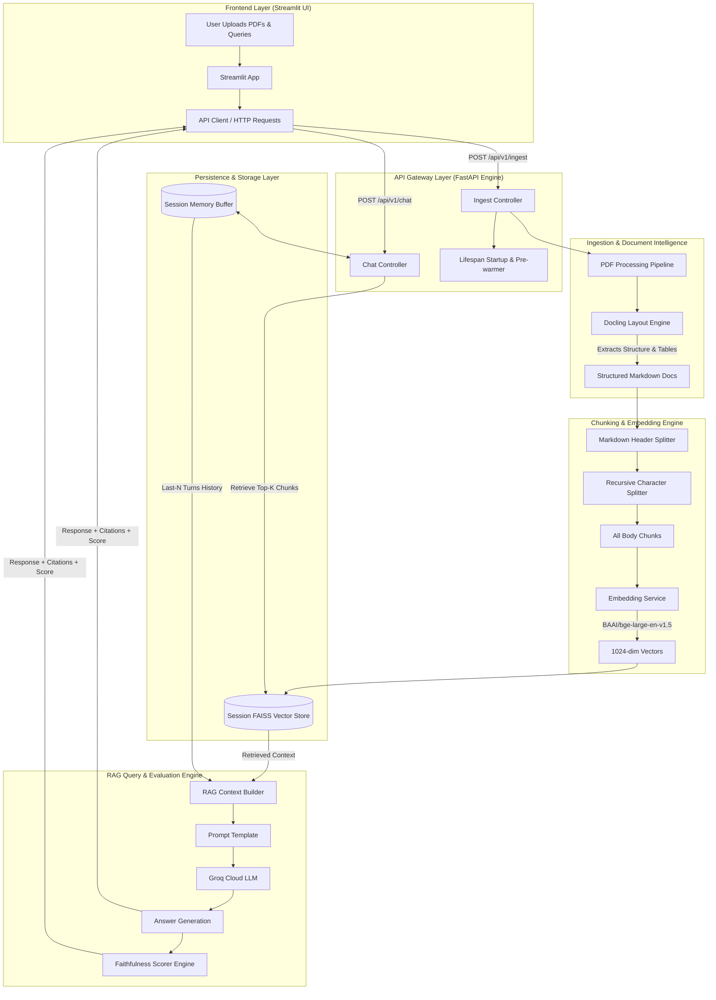

# 🚀 MultiPDF Research Agent: Structure-Aware Decoupled RAG Engine

[](https://fastapi.tiangolo.com/)
[](https://streamlit.io/)
[](https://groq.com/)
[](https://www.docker.com/)
[](https://www.python.org/)

A production-grade, microservice-based Retrieval-Augmented Generation (RAG) system built to analyze complex academic PDFs (IEEE multi-column layouts, embedded Markdown tables, and structured figures).

---

## 🏗️ System Architecture Flowchart



---

## ✨ Key Technical Features

1. **Decoupled Microservice Design**: Streamlit serves exclusively as a UI presentation layer communicating with a non-blocking FastAPI backend.
2. **Deep-Learning Layout Parsing (Docling)**: Replaces naive top-to-bottom text extractors by preserving reading order, multi-column continuity, and Markdown tables (`|---|`).
3. **High-Density Vector Storage**: Utilizes `BAAI/bge-large-en-v1.5` (1024-dimensional embeddings) paired with isolated per-session FAISS indices to prevent multi-tenant data leakage.
4. **Fault-Tolerant LPU Inference**: Powered by Groq (`openai/gpt-oss-120b` / `llama-3.3-70b-versatile`) wrapped in `tenacity` exponential backoff retries for 429/503 status resilience.
5. **Faithfulness & Grounding Guardrails**: Evaluates contextual overlap to assign real-time hallucination risk metrics (🟢 High, 🟡 Medium, 🔴 Low) alongside page and section citations.

---

## 🛠️ Tech Stack

* **Backend Framework:** FastAPI (Python 3.12)
* **Frontend UI:** Streamlit (Multi-page dashboard & real-time chat)
* **Document Parsing:** Docling (Structure-aware deep learning parser)
* **Embeddings:** `BAAI/bge-large-en-v1.5` (1024-dim Hugging Face model)
* **Vector Database:** FAISS (Isolated session indices)
* **LLM Provider:** Groq Cloud (`openai/gpt-oss-120b`)
* **Resilience & Testing:** Tenacity (Retries) & Pytest
* **Containerization:** Docker & Docker Compose

---

## 🚀 Quickstart Guide

### 1. Prerequisites

Ensure you have Python 3.12+, Git, and Docker installed.

### 2. Environment Setup

Clone the repository and create a `.env` file in the root directory:

```bash
git clone [https://github.com/your-username/multipdf-agent.git](https://github.com/your-username/multipdf-agent.git)
cd multipdf-agent

```

Create a `.env` file:

```ini
PROJECT_NAME="MultiPDF Research Agent"
LOG_LEVEL="INFO"

# API Credentials
GROQ_API_KEY="gsk_your_groq_api_key_here"
GEMINI_API_KEY="dummy_key_for_pydantic_validation"

# Hyperparameters
RETRIEVAL_K=6
MAX_MEMORY_TURNS=5
FAISS_INDEX_DIR="faiss_index"

```

---

### 3. Running Locally (Development Mode)

#### Step A: Set up Virtual Environment & Dependencies

```powershell
# Create & Activate Virtual Environment
python -m venv .venv
.\.venv\Scripts\Activate.ps1

# Install Backend & Frontend Requirements
pip install -r backend/requirements.txt
pip install -r frontend/requirements.txt

```

#### Step B: Launch FastAPI Backend

```powershell
$env:PYTHONPATH="backend"
uvicorn app.main:app --reload --port 8000

```

#### Step C: Launch Streamlit Frontend (New Terminal Tab)

```powershell
streamlit run frontend/app.py --server.port 8501

```

Access the app at `http://localhost:8501` and the API docs at `http://localhost:8000/docs`.

---

### 4. Running via Docker Compose

To spin up the entire application stack in isolated containers:

```bash
docker-compose up --build

```

---

## 🧪 Running Automated Tests

Run unit, RAG grounding, and endpoint integration tests:

```bash
cd backend
pytest tests/ -v

```

---

## 📊 Analytics & Monitoring

Navigate to the **Analytics** page in the Streamlit sidebar (`pages/1_Analytics.py`) to inspect:

* Real-time query volume and session faithfulness averages.
* Section citation distribution charts across uploaded papers.
* Detailed grounding audit logs per user turn.

---

## 📜 License

Distributed under the MIT License. See `LICENSE` for more information.

```

```
